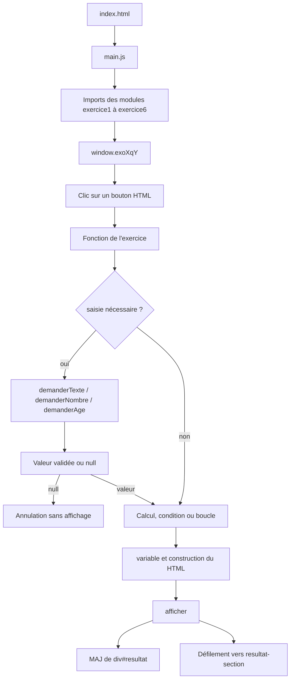

# Exercices JavaScript - Documentation technique

## Sommaire

- [A. Présentation du projet](#a-présentation-du-projet)
- [B. Architecture du projet](#b-architecture-du-projet)
- [C. Fonctionnement de l'architecture modulaire](#c-fonctionnement-de-larchitecture-modulaire)
- [D. Analyse détaillée de la logique de programmation](#d-analyse-détaillée-de-la-logique-de-programmation)
- [E. Fonctions utilitaires et réutilisation](#e-fonctions-utilitaires-et-réutilisation)
- [F. Gestion des erreurs et validation](#f-gestion-des-erreurs-et-validation)
- [G. Flux d'exécution du programme](#g-flux-dexécution-du-programme)
- [H. Design et démarche de développement avec l'IA](#h-design-et-démarche-de-développement-avec-lia)
- [I. Installation et exécution](#i-installation-et-exécution)
- [J. Limites et perspectives d'évolution](#j-limites-et-perspectives-dévolution)

---

## A. Présentation du projet

### Nom du projet

**Exercices JavaScript**

### Description

Ce projet est une plateforme pédagogique exécutée entièrement dans le navigateur. Elle regroupe des exercices JavaScript organisés en six parties :

1. Variables et types
2. Opérateurs et comparaisons
3. Structures conditionnelles
4. Structure `switch`
5. Boucles
6. Simulation de mot de passe

L'utilisateur choisit une question avec les boutons de la page. Selon la question, le programme affiche immédiatement un résultat ou demande une ou plusieurs saisies à l'aide de fenêtres `prompt()`. Les résultats sont insérés dans la section `Résultat`.

Le projet est volontairement orienté vers la pratique des fondamentaux : déclarations, types, opérateurs, conditions, boucles, modules et validation de saisies.

### Objectifs pédagogiques

- Comprendre les types primitifs JavaScript.
- Manipuler des variables numériques, textuelles et booléennes.
- Utiliser les opérateurs arithmétiques, logiques et de comparaison.
- Construire des conditions avec `if`, `else if`, `else` et le ternary operator.
- Utiliser une instruction `switch`.
- Réaliser des répétitions avec des boucles `for`, `do...while` et `while`.
- Distinguer une saisie correcte, incorrecte, vide ou annulée.
- Séparer le code en modules réutilisables.
- Comprendre le passage entre une interface HTML, du JavaScript et l'affichage DOM.

### Technologies utilisées

| Technologie | Usage réel dans le projet |
|---|---|
| HTML5 | Structure de la page et boutons des exercices |
| CSS3 | Mise en page, design minimal et adaptation mobile |
| JavaScript ES modules | Logique des exercices et organisation en fichiers |
| DOM JavaScript | Recherche de `#resultat` et insertion du contenu HTML |
| API `prompt()` et `alert()` | Collecte et validation des saisies |
| `scrollIntoView()` | Déplacement animé vers la section de résultat |
| Live Server ou serveur HTTP local | Chargement des modules JavaScript |

Le projet n'utilise aucun framework, aucune bibliothèque externe et aucun serveur backend.

### Fonctionnalités principales

- Six sections d'exercices accessibles depuis la page principale.
- Deux à quatre questions par exercice.
- Saisie interactive par fenêtres `prompt()`.
- Affichage centralisé dans l'élément `#resultat`.
- Résultats stylés pour différencier les noms de variables et leurs valeurs.
- Validation de certaines saisies numériques et textuelles.
- Vérification des notes entre 0 et 20.
- Limitation des tentatives de mot de passe à trois essais.
- Défilement automatique et doux vers les résultats.
- Adaptation responsive sur petits écrans.

---

## B. Architecture du projet

### Arborescence réelle

```text
TP2_Dev_Web/
|-- index.html
|-- README.md
|-- css/
|   `-- style.css
`-- js/
    |-- main.js
    |-- exercice1/
    |   `-- exercice1.js
    |-- exercice2/
    |   `-- exercice2.js
    |-- exercice3/
    |   `-- exercice3.js
    |-- exercice4/
    |   `-- exercice4.js
    |-- exercice5/
    |   `-- exercice5.js
    |-- exercice6/
    |   `-- exercice6.js
    `-- utils/
        |-- affichage.js
        `-- saisie.js
```

### Rôle de chaque fichier

#### `index.html`

`index.html` constitue le point d'entrée de l'application.

- Charge `css/style.css`.
- Affiche le titre et la liste des six exercices.
- Déclare chaque bouton avec un appel tel que `onclick="exo1q1()"`.
- Contient la zone finale `<div id="resultat">`.
- Associe une valeur `aria-live="polite"` à cette zone afin que les changements soient annoncés aux lecteurs d'écran.
- Charge `js/main.js` avec `type="module"`.

#### `css/style.css`

Le fichier CSS définit l'apparence réelle de la page :

- arrière-plan clair et texte sombre ;
- largeur maximale du contenu et marges importantes ;
- mise en page en grille pour les exercices ;
- numéros `01` à `06` ;
- boutons avec bordure, forme arrondie et changement au survol ;
- zone de résultat avec bordure gauche ;
- classes `.variable` et `.valeur` utilisées par la fonction `variable()` ;
- adaptation de la disposition en colonnes sur les écrans inférieurs à 600 px.

#### `js/main.js`

`main.js` est le pont entre les modules ES et les attributs HTML `onclick`.

Il importe les fonctions de chaque exercice, puis les expose sur l'objet global `window`. Cela permet à un attribut `onclick="exo1q1()"` présent dans le HTML de retrouver la fonction correspondante au chargement du module.

#### `js/utils/affichage.js`

Ce module centralise l'affichage.

- `afficher()` récupère l'élément DOM `#resultat` et remplace son contenu HTML.
- `variable()` transforme une variable JavaScript en affichage HTML stylé.
- `afficher()` déclenche également le déplacement animé vers `.resultat-section`.
- Si le navigateur indique une préférence pour les mouvements réduits, le défilement devient instantané.

#### `js/utils/saisie.js`

Ce module centralise les interactions répétitives avec `prompt()` :

- `demanderTexte()` récupère une chaîne non vide.
- `demanderNombre()` récupère un nombre fini.
- `demanderAge()` exige un nombre entier supérieur ou égal à zéro.

Une saisie annulée retourne `null` de façon uniforme, permettant aux fonctions appelantes de quitter l'action avec `return`.

#### Modules des exercices

Chaque dossier contient un module de niveau pédagogique :

| Fichier | Responsabilité |
|---|---|
| `js/exercice1/exercice1.js` | Variables simples et saisies de type texte/nombre |
| `js/exercice2/exercice2.js` | Opérations arithmétiques et moyenne |
| `js/exercice3/exercice3.js` | Conditions liées à l'âge, au pays et à une note |
| `js/exercice4/exercice4.js` | Conversion de nombre ou de texte avec `switch` |
| `js/exercice5/exercice5.js` | Boucles `for` et factorielle |
| `js/exercice6/exercice6.js` | Boucles de vérification et tentative de mot de passe |

---

## C. Fonctionnement de l'architecture modulaire

### Pourquoi séparer le code

La séparation en modules présente plusieurs avantages adaptés à ce projet :

- chaque exercice possède un fichier indépendant ;
- les besoins communs, comme la saisie et l'affichage, sont réutilisés ;
- `main.js` reste responsable du raccordement avec l'interface ;
- une modification de l'affichage n'oblige pas à modifier les six modules ;
- chaque fonction peut être identifiée et expliquée séparément.

### Import et export

Un module exporte une fonction avec le mot-clé `export` :

```javascript
export function exo1q1() {
    // instructions
}
```

Un autre module peut ensuite l'importer :

```javascript
import { exo1q1, exo1q2 } from "./exercice1/exercice1.js";
```

Dans le projet réel, les modules des exercices exportent leurs fonctions et importent les utilitaires :

```javascript
import { afficher, variable } from "../utils/affichage.js";
import { demanderTexte, demanderAge } from "../utils/saisie.js";
```

### Rôle de `main.js`

`main.js` charge les fonctions nécessaires :

```javascript
window.exo1q1 = exo1q1;
window.exo2q1 = exo2q1;
window.exo3q4 = exo3q4;
```

Une fonction exportée peut être utilisée directement par un autre module, mais elle reste par défaut dans l'espace du module. L'attribution à `window` permet l'appel indirect depuis les attributs HTML comme `onclick`.

### Pourquoi utiliser `type="module"`

Dans `index.html` :

```html
<script type="module" src="js/main.js"></script>
```

Cet attribut indique au navigateur d'utiliser les fonctionnalités ES modules. Il permet notamment :

- les instructions `import` et `export` ;
- l'exécution dans une portée de module et non directement dans la portée globale ;
- une meilleure séparation des dépendances ;
- l'explication explicite des chemins `.js`.

Les imports de fichiers locaux peuvent être bloqués si la page est ouverte directement avec `file://`. Il faut donc exécuter le projet depuis un serveur HTTP local.

### Communication entre les modules

```text
index.html
   ↓ appelle une fonction globale
main.js
   ↓ importe le module d'un exercice
exerciceX.js
   ↓ importe affichage.js et/ou saisie.js
utilitaires
   ↓ modifie le DOM ou retourne une valeur
index.html
```

Les modules ne communiquent pas avec des variables globales propres aux exercices. Ils échangent principalement par :

1. les valeurs retournées par les fonctions utilitaires ;
2. les arguments envoyés à `afficher()` ou `variable()` ;
3. la modification du DOM par `afficher()`.

---

## D. Analyse détaillée de la logique de programmation

## Exercice 1 - Variables et types

### Question 1 : variables prédéfinies

**Problème à résoudre.** Démontrer la création de variables et l'affichage de différents types.

**Entrées.** Aucune : les données sont définies directement dans la fonction.

**Variables utilisées.**

| Variable | Valeur | Type JavaScript |
|---|---:|---|
| `nom` | `"Aymane"` | chaîne |
| `age` | `20` | nombre |
| `etudiant` | `true` | booléen |

**Traitement.**

```javascript
const nom = "Aymane";
const age = 20;
const etudiant = true;
```

Le code passe ensuite ces valeurs à `variable()` :

```javascript
${variable("nom", nom)}
${variable("age", age)}
${variable("etudiant", etudiant)}
```

`variable()` échappe le nom et la valeur avant de produire du HTML contenant les classes CSS `.variable` et `.valeur`.

**Résultat attendu.**

```text
nom = Aymane
age = 20
etudiant = true
```

### Question 2 : variables saisies

**Problème à résoudre.** Collecter trois informations personnelles et les afficher.

**Données d'entrée.** Nom, âge et ville.

**Variables utilisées.**

```javascript
const nom = demanderTexte("Entrez votre nom :");
const age = demanderAge("Entrez votre âge :");
const ville = demanderTexte("Entrez votre ville :");
```

**Traitement.** Chaque saisie dépend de la précédente.

```javascript
if (nom === null) return;
```

Cette vérification permet d'annuler toute l'action si l'utilisateur ferme une fenêtre `prompt()`. Ensuite, `demanderAge()` retourne soit un entier positif, soit `null`. Enfin, `variable()` prépare l'affichage du nom, de l'âge et de la ville.

## Exercice 2 - Opérateurs et comparaisons

### Question 1 : opérations arithmétiques

**Données d'entrée.**

```javascript
const a = 10;
const b = 3;
```

**Traitements réalisés.**

| Opération | Expression | Résultat |
|---|---|---:|
| Somme | `a + b` | 13 |
| Différence | `a - b` | 7 |
| Produit | `a * b` | 30 |
| Division | `a / b` | 3.333... |
| Reste | `a % b` | 1 |

L'opérateur `%` retourne le reste de la division entière.

### Question 2 : moyenne et parité

**Données d'entrée.** Deux nombres saisis par l'utilisateur.

**Traitements.**

```javascript
const moyenne = (a + b) / 2;
```

Le programme vérifie ensuite si la moyenne est entière avec `Number.isInteger(moyenne)`. Si elle est entière, le reste de la division par deux détermine sa parité :

```javascript
moyenne % 2 === 0 ? "Paire" : "Impaire"
```

Si la moyenne est décimale, le code ne tente pas de déterminer une parité et affiche un message explicite.

**Limite.** La parité n'est vérifiée que sur une moyenne entière en JavaScript. Une moyenne comme 3.5 est considérée comme décimale.

## Exercice 3 - Structures conditionnelles

### Question 1 : vérification de l'âge

**Entrée.** Un âge entier positif.

**Condition utilisée.**

```javascript
age >= 18 ? "Accès autorisé." : "Accès refusé."
```

C'est une condition ternaire : si la condition est vraie, le premier texte est choisi ; sinon, le second l'est.

### Question 2 : âge et pays

**Entrées.** L'âge et le pays.

**Traitements.**

```javascript
if (age >= 18 && pays.toLowerCase() === "maroc") {
    message = "Accès autorisé.";
} else if (age >= 18) {
    message = "Vous êtes majeur, mais vous êtes étranger.";
} else {
    message = "Accès refusé.";
}
```

- `&&` exige que les deux conditions soient vraies.
- `toLowerCase()` normalise le pays pour accepter des saisies comme « Maroc », « MAROC » ou « maroc ».
- L'ordre des conditions est important : le cas « Maroc + majeur » est évalué en premier.

### Question 3 : appréciation à partir d'une note

**Entrée.** Une note numérique.

**Validation de limites.**

```javascript
if (note < 0 || note > 20) {
    afficher("La note doit être comprise entre 0 et 20.");
    return;
}
```

**Chainage de conditions.**

| Note | Appréciation |
|---:|---|
| 16 à 20 | Excellent |
| 14 à 15.999... | Bien |
| 12 à 13.999... | Assez bien |
| Moins de 12, dans l'intervalle valide | Insuffisant |

### Question 4 : gestion explicite des erreurs

Cette fonction utilise directement `prompt()` au lieu de `demanderNombre()`.

```javascript
const saisie = prompt("Entrez votre note :");
const note = Number(saisie.trim().replace(",", "."));
```

Après l'annulation éventuelle, elle vérifie :

1. une chaîne vide ;
2. une valeur qui ne peut pas être convertie en nombre avec `isNaN(note)` ;
3. une valeur hors de l'intervalle 0 à 20 ;
4. le cas valide, avec les mêmes paliers que la question 3.

La virgule décimale est remplacée par un point afin que `Number()` puisse convertir des saisies comme `12,5`.

## Exercice 4 - Structure `switch`

### Question 1 : nombre vers jour de la semaine

**Entrée.** Une valeur numérique entre 1 et 7.

**Traitement.** Une instruction `switch` compare la valeur avec les cas 1 à 7 :

```javascript
switch (nombre) {
    case 1: jour = "Lundi"; break;
    case 2: jour = "Mardi"; break;
    // ...
    default: jour = "Nombre invalide";
}
```

La comparaison du `switch` est stricte. `demanderNombre()` convertit les saisies numériques avant l'appel, mais il faut saisir 1 à 7 sans décimale pour correspondre à un `case`. Toute autre valeur tombe dans `default` et affiche « Nombre invalide ». L'intervalle 1 à 7 n'est pas vérifié séparément avant le `switch`.

### Question 2 : jour suivant

**Entrée.** Le nom d'un jour.

**Traitement.** Le programme normalise la saisie :

```javascript
jour.toLowerCase().trim()
```

Puis `switch` associe chaque jour à son successeur. Dimanche revient à Lundi. Tout autre texte retourne « Jour invalide ». La version actuelle accepte les majuscules et les espaces autour du texte, mais pas les accents, abréviations ou variantes.

## Exercice 5 - Boucles

### Question 1 : nombres de 1 à 10

**Entrées.** Aucune saisie.

**Boucle utilisée.**

```javascript
for (let i = 1; i <= 10; i++) {
    resultat += `${variable("nombre", i)}<br>`;
}
```

Le tableau d'itération est construit comme ceci :

| Phase | Valeur initialisée | Condition | Incrémentation |
|---|---:|---|---|
| Initialisation | `i = 1` | Vérifiée avant chaque passage | |
| Répétition | | `i <= 10` | |
| Progression | | | `i++` |

À chaque passage, une ligne HTML est ajoutée à `resultat`.

### Question 2 : nombres pairs

**Entrées.** Aucun utilisateur ni paramètre d'entrée.

**Traitement.** La boucle parcourt les nombres de 1 à 20.

```javascript
if (i % 2 === 0) {
    resultat += `${variable("nombre pair", i)}<br>`;
}
```

Le reste de la division par 2 vaut zéro uniquement pour les nombres pairs.

**Résultat attendu.** 2, 4, 6, 8, 10, 12, 14, 16, 18 et 20.

### Question 3 : factorielle

**Problème à résoudre.** Calculer `nombre!`.

**Entrée.** Un nombre entier positif.

**Validation.**

```javascript
if (!Number.isInteger(nombre) || nombre < 0) {
    afficher("Veuillez entrer un entier positif.");
    return;
}

if (nombre > 170) {
    afficher("Nombre trop grand pour calculer la factorielle avec précision.");
    return;
}
```

Le premier contrôle rejette les décimales et les négatifs. Le second limite le calcul à une valeur sélectionnée pour éviter les dépassements de précision du type `Number` en JavaScript.

**Calcul.**

```javascript
let factorielle = 1;
for (let i = 1; i <= nombre; i++) {
    factorielle *= i;
}
```

Pour `5`, l'accumulateur passe successivement par 1, 1, 2, 6, 24 puis 120.

## Exercice 6 - Simulation de mot de passe

### Question 1 : mot de passe sans limite

**Problème à résoudre.** Redemander le mot de passe jusqu'à obtenir la bonne valeur.

```javascript
let motDePasse;

do {
    motDePasse = prompt("Entrez le mot de passe :");
    if (motDePasse === null) return;

    if (motDePasse !== "emsi2025") {
        alert("Mot de passe incorrect. Réessayez.");
    }
} while (motDePasse !== "emsi2025");
```

La comparaison exacte exige la chaîne `emsi2025`. La boucle `do...while` garantit au moins une saisie avant la vérification. L'annulation quitte immédiatement le programme. Aucun plafond de tentatives n'est défini dans cette question.

### Question 2 : maximum de trois essais

**Variables principales.**

```javascript
let motDePasse;
let tentatives = 0;
const maximum = 3;
```

La boucle `while` continue tant que le compteur est inférieur à 3 :

```javascript
while (tentatives < maximum) {
    motDePasse = prompt("Entrez le mot de passe :");
    if (motDePasse === null) return;

    tentatives++;
    if (motDePasse === "emsi2025") {
        afficher(...);
        return;
    }
}
```

Chaque prompt génère une tentative, que le mot de passe soit correct ou non. Après trois échecs, l'affichage indique « Compte bloqué ».

---

## E. Fonctions utilitaires et réutilisation

### `afficher(message)`

```javascript
export function afficher(message) {
    const zoneResultat = document.getElementById("resultat");
    if (zoneResultat !== null) {
        zoneResultat.innerHTML = message;
    }
}
```

Elle centralise l'injection dans le DOM. Si `#resultat` existe, elle remplace le contenu précédent par le contenu HTML reçu.

Elle déclenche ensuite `scrollIntoView()` sur la section contenant le résultat. Cette méthode offre un défilement fluide, sauf si le navigateur indique une préférence `prefers-reduced-motion`.

### `variable(nom, valeur)`

Cette fonction :

1. convertit le nom et la valeur en chaînes avec `String()`;
2. échappe les caractères HTML potentiellement dangereux ;
3. retourne deux `<span>` avec les classes `.variable` et `.valeur`.

Les caractères échappés sont notamment `&`, `<`, `>`, `"` et `'`. Cette sécurisation évite qu'une saisie textuelle soit interprétée comme du HTML lors de son affichage.

### `demanderTexte(message)`

Cette fonction utilise une boucle `do...while` jusqu'à obtenir une chaîne non vide :

- ferme la boucle avec `null` si `prompt()` est annulé ;
- supprime les espaces de début et de fin avec `trim()` ;
- affiche une alerte pour une chaîne vide.

Elle est utilisée pour le nom, la ville, le pays et les jours.

### `demanderNombre(message)`

Cette fonction normalise et convertit une saisie :

```javascript
const saisieNormalisee = saisie.trim().replace(",", ".");
nombre = Number(saisieNormalisee);
```

Elle retourne `null` en cas d'annulation. Elle refuse les chaînes vides, les textes invalides, `NaN` et les valeurs infinies avec `Number.isFinite()`. Les points et virgules décimaux sont gérés grâce à la normalisation.

### `demanderAge(message)`

Cette fonction repose sur `demanderNombre()` :

```javascript
if (!Number.isInteger(age) || age < 0)
```

Elle exige donc une valeur entière positive ou nulle. Elle affiche un avertissement et redemande tant que cette règle n'est pas respectée.

### Pourquoi centraliser ces fonctions

Sans ces utilitaires, chaque exercice contiendrait des blocs similaires pour les saisies, la vérification, l'affichage et les caractères HTML. Centraliser le traitement apporte quatre bénéfices :

- comportement cohérent ;
- moins de répétition ;
- maintenance plus simple ;
- séparation entre logique métier et interactions.

---

## F. Gestion des erreurs et validation

| Situation | Comportement réel |
|---|---|
| Champ texte vide | `demanderTexte()` affiche « Veuillez saisir une valeur. » puis redemande |
| Champ numérique vide | `demanderNombre()` affiche « Veuillez saisir un nombre valide. » puis redemande |
| Texte saisi à la place d'un nombre | `Number()` retourne `NaN` ou la valeur est non finie ; une alerte est affichée |
| Âge négatif | `demanderAge()` affiche une alerte puis redemande |
| Âge décimal | `demanderAge()` exige `Number.isInteger(age)` |
| Saisie annulée | Les fonctions utilitaires et la plupart des exercices retournent `null` |
| Note hors de 0 à 20 | Les questions 3 et 4 affichent un message puis arrêtent le traitement |
| Factorielle négative ou décimale | Le calcul est rejeté |
| Factorielle supérieure à 170 | Le calcul est refusé par un contrôle explicite |
| Mot de passe incorrect | Alerte ou conservation du compteur selon la version |
| Mot de passe annulé | Les fonctions de l'exercice 6 quittent |
| Mot de passe correct | Le programme affiche un message de bienvenue |

### Limites des validations existantes

- Les fonctions utilitaires ne garantissent pas qu'un entier soit dans un intervalle spécifique lorsque l'appelant ne vérifie pas cet intervalle lui-même.
- `demanderNombre()` ne distingue pas un zéro de l'annulation.
- `demanderAge()` ne définit pas de maximum réaliste.
- `exo4q1` vérifie les 7 jours par le `switch`, mais accepte une décimale puis retourne « Nombre invalide ».
- Le jour saisi n'est pas validé par une liste de jours accentués ou formatés.
- `exo6q1` ne limite pas le nombre de tentatives.
- Le mot de passe est visible dans le code côté navigateur et ne constitue donc pas une authentification réelle.
- Les saisies sont traitées côté client, sans aucune persistance ni protection serveur.
- En JavaScript, les nombres sont représentés comme des nombres à virgule flottante. Les factoriels élevés peuvent perdre en précision.
- `variable()` échappe les résultats affichés, mais les données ne sont pas transférées vers une base ni contrôlées côté serveur.

---

## G. Flux d'exécution du programme

### Parcours complet

Le parcours typique est :

```text
index.html
   -> chargement de style.css
   -> chargement de js/main.js avec type="module"
main.js
   -> importe les modules d'exercices
   -> affecte les fonctions à window
Utilisateur
   -> clique sur un bouton
   -> onclick appelle la fonction globale
Module de l'exercice
   -> demande éventuellement une saisie avec prompt()
   -> effectue les calculs ou vérifications
Fonctions utilitaires
   -> demandent et valident la saisie
   -> formatent ou échappent les données
afficher()
   -> remplace le contenu de #resultat
   -> déplace l'écran vers la section résultat
```

### Diagramme Mermaid



---

## H. Design et démarche de développement avec l'IA

### Démarche de développement et utilisation de l'IA

L'intelligence artificielle a été utilisée comme outil d'assistance pour améliorer certains aspects de présentation du projet, notamment :

- la simplification de l'organisation visuelle ;
- les choix CSS liés aux couleurs, espacements, bordures et typographie ;
- l'organisation esthétique de la page ;
- la mise en page responsive ;
- certaines améliorations de l'expérience utilisateur, dont le défilement vers les résultats ;
- la réduction du caractère visuellement générique de l'interface.

Cette utilisation doit être comprise comme une assistance pédagogique et technique. Elle ne signifie pas que toutes les technologies utilisées sont maîtrisées de façon approfondie ni que les choix graphiques ont été élaborés de manière indépendante.

Mon intérêt personnel et le sens de mon apprentissage se situent davantage dans :

- la logique algorithmique ;
- la résolution de problèmes ;
- la conception des fonctionnalités ;
- la logique métier ;
- l'architecture logicielle ;
- le backend ;
- la gestion et la persistance des données.

Le projet est donc un support d'apprentissage : le code permet de comprendre comment les données circulent, comment elles sont validées et comment un résultat est produit. L'étude du système est privilégiée par rapport à une recherche de décoration superficielle. Les améliorations visuelles doivent rester compréhensibles et pouvoir être expliquées, adaptées ou réécrites sans dépendre automatiquement de l'IA.

---

## I. Installation et exécution

### Prérequis

- Un navigateur web moderne.
- Visual Studio Code ou un éditeur compatible.
- L'extension VS Code **Live Server**, ou tout serveur HTTP local.
- Aucun gestionnaire de dépendances n'est nécessaire.

### Ouvrir dans VS Code

1. Ouvrir Visual Studio Code.
2. Utiliser `Fichier > Ouvrir le dossier...`.
3. Sélectionner le dossier `TP2_Dev_Web`.
4. Vérifier que `index.html` se trouve à la racine du projet.
5. Vérifier que les dossiers `css` et `js` sont présents.

### Lancer avec Live Server

1. Ouvrir `index.html`.
2. Faire un clic droit dans l'éditeur.
3. Choisir **Open with Live Server**.
4. Attendre l'ouverture de la page dans le navigateur.

L'accès doit normalement ressembler à :

```text
http://127.0.0.1:5500/
```

Le port peut varier selon la configuration de Live Server.

### Test des exercices

| Partie | Questions à tester |
|---|---|
| Exercice 1 | Affichage automatique des types ; saisie du nom, âge et ville |
| Exercice 2 | Résultats fixes ; moyenne décimale et moyenne entière |
| Exercice 3 | Âge 17/18 ; pays « Maroc/autre » ; notes limites comme 11, 12, 14, 16 |
| Exercice 4 | Nombres de 1 à 7 ; jours avec majuscules ou espaces |
| Exercice 5 | Affichage de 1 à 10 ; nombres pairs ; factorielle positive et limite |
| Exercice 6 | Mot de passe correct ; mot de passe incorrect ; annulation ; troisième essai |

Pour tester l'annulation, fermer la fenêtre `prompt()` au lieu de saisir une valeur.

### Vérifications utiles

- Ouvrir les outils de développement du navigateur avec `F12`.
- Consulter l'onglet **Console** en cas de fichier non chargé.
- Vérifier que les chemins des imports correspondent exactement aux noms des dossiers.
- Tester le site avec une largeur de fenêtre inférieure à 600 px.
- Vérifier que le défilement vers la zone de résultat fonctionne après chaque clic.

---

## J. Limites et perspectives d'évolution

### Limitations actuelles

Le projet est une application pédagogique statique côté client.

- Il ne possède aucune base de données.
- Il ne possède aucune API.
- Il ne possède aucun backend.
- Il ne conserve aucune saisie après actualisation de la page.
- Il ne possède pas de comptes utilisateurs.
- Il ne possède pas d'authentification réelle.
- Le mot de passe visible dans le JavaScript n'est pas sécurisé.
- Les erreurs sont majoritairement gérées par des `alert()` ou des fenêtres de saisie.
- Les tests automatisés ne sont pas inclus dans l'arborescence actuelle.

### Évolutions réalistes

Les propositions suivantes sont des perspectives, pas des fonctionnalités déjà présentes.

#### Structure et interface

- Remplacer les attributs HTML `onclick` par des écouteurs `addEventListener()`.
- Fournir des formulaires HTML à la place de `prompt()`.
- Ajouter des messages d'erreur associés aux champs.
- Conserver les résultats associés à l'exercice actif.
- Ajouter des identifiants ou libellés structurés pour les sorties.
- Ajouter un état actif au bouton sélectionné.

#### Gestion des données

- Ajouter un fichier ou un état JavaScript persistant pour les résultats.
- Utiliser `localStorage` pour une sauvegarde locale simple.
- Préparer des structures JSON pour chaque exercice.
- Créer un historique des essais réalisés.

#### Backend et données

- Ajouter une API HTTP avec Node.js, par exemple.
- Créer des routes pour enregistrer les exercices effectués.
- Ajouter une base de données relationnelle ou NoSQL.
- Séparer les données de l'interface.
- Centraliser les règles de validation côté serveur.

#### Authentification

- Ajouter des comptes utilisateurs.
- Remplacer le mot de passe pédagogique par un vrai mécanisme d'authentification.
- Hacher les mots de passe côté serveur.
- Ne jamais conserver de mot de passe en clair dans le JavaScript.

#### Suivi pédagogique

- Enregistrer les exercices terminés.
- Calculer la progression par exercice.
- Afficher l'historique des résultats.
- Ajouter des scores ou niveaux d'achèvement.
- Permettre de recommencer une question.

#### Qualité et tests

- Ajouter des tests unitaires pour les utilitaires.
- Tester les validations numériques et textuelles.
- Tester les bornes des notes.
- Tester les cas limites de la factorielle.
- Tester le mot de passe avec trois essais.
- Ajouter des tests DOM d'intégration.
- Intégrer les tests dans une commande automatisée.

Ces évolutions permettraient de faire passer le projet d'une collection de fonctions pédagogiques à une application plus complète tout en conservant une séparation claire entre la logique, l'interface, les données et les fonctionnalités backend.
